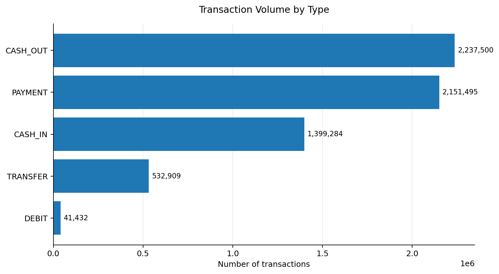
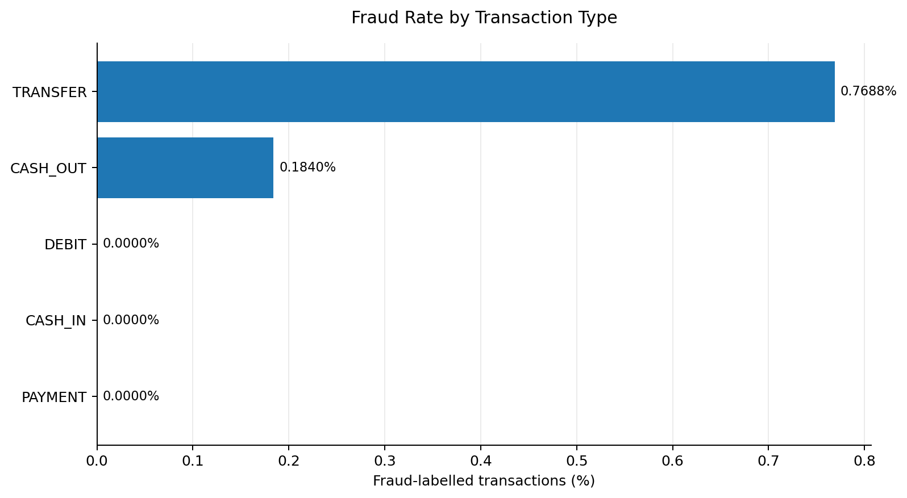
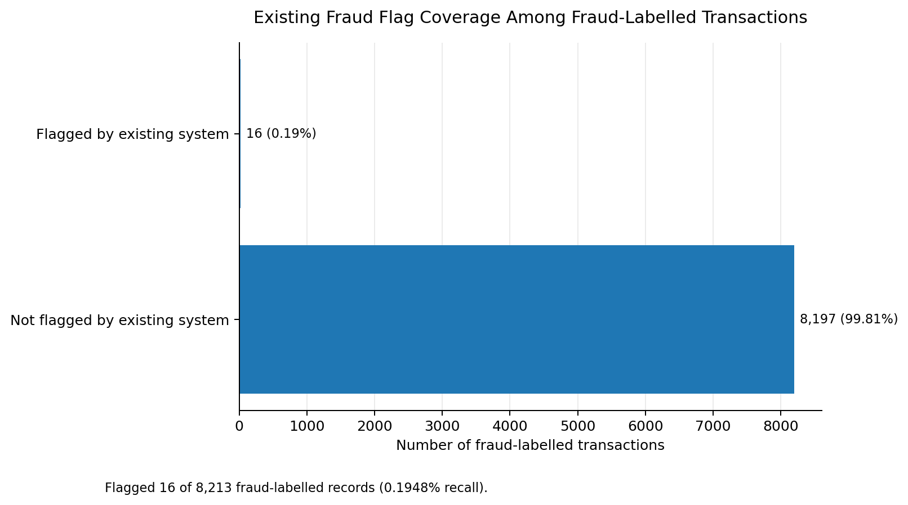

# Fintech Fraud Intelligence: SQL Analysis of Financial Transactions

A data analytics portfolio project using PostgreSQL to investigate transaction patterns, identify fraud-related behavior, evaluate existing fraud flags, and develop rule-based risk insights from 6.36 million synthetic financial transactions.

## Project Overview

Financial fraud detection is an important challenge for financial institutions. This project uses SQL to explore transaction data, assess data quality, analyze fraud patterns, and evaluate how effectively existing fraud flags identify fraudulent transactions.

**Tools:** PostgreSQL, SQL, CSV, Git, GitHub
**Dataset:** PaySim synthetic mobile money transaction dataset
**Records analyzed:** 6,362,620 transactions
**Project type:** Exploratory SQL analysis and rule-based risk investigation

> This project is an SQL analytics project. It does not claim to be a trained machine learning fraud detection model.

## Business Questions

- How are transactions distributed across transaction types?
- What proportion of transactions are labelled as fraudulent?
- Which transaction types contain the most fraud cases?
- How well does the existing fraud flag cover fraud-labelled transactions?
- What transaction characteristics could support further fraud investigation?
- Are there data quality issues that could affect analysis?

## Key Findings

- **6,362,620 transactions** were analyzed.
- **8,213 transactions** were labelled as fraudulent, approximately **0.1291%** of all transactions.
- **CASH_OUT** and **TRANSFER** accounted for all fraud-labelled transactions in this synthetic dataset.
- The fraud rate was approximately **0.1840% for CASH_OUT** and **0.7688% for TRANSFER**.
- The existing fraud flag identified only **16 fraud-labelled transactions**. Its recall against the dataset's fraud labels was approximately **0.1948%**.
- The initial data quality checks found no missing values in the checked key fields, no unexpected transaction types, no negative transaction amounts, no invalid fraud labels or flag values, and no exact duplicate rows under the query used.

These findings describe this dataset and should not be interpreted as universal patterns of real-world financial fraud.

## Visual Insights

### 1. Transaction Volume by Type



### 2. Fraud Rate by Transaction Type



### 3. Existing Fraud Flag Coverage



Additional chart notes and the transaction summary CSV are available in `results/charts/`.

## Technical Skills Demonstrated

- Writing SQL queries for large datasets
- Data quality and validation checks
- Aggregation, grouping, filtering, and conditional logic
- Fraud-rate and transaction-type analysis
- Evaluating existing fraud-flag coverage
- Rule-based risk analysis
- Communicating findings through charts and documentation
- Organizing an analytics project for GitHub

## Repository Structure

```text
fintech-fraud-intelligence/
├── docs/
│   ├── business_rules.md
│   └── data_dictionary.md
├── results/
│   ├── charts/
│   │   ├── 01_transaction_volume_by_type.png
│   │   ├── 02_fraud_rate_by_type.png
│   │   ├── 03_existing_flag_coverage.png
│   │   ├── README_visualizations.md
│   │   └── transaction_type_summary.csv
│   └── findings.md
├── sql/
│   ├── 01_schema.sql
│   ├── 02_data_quality.sql
│   ├── 02_fraud_analysis.sql
│   ├── 03_basic_analysis.sql
│   ├── 04_fraud_analysis.sql
│   ├── 04_fraud_rules.sql
│   ├── 05_risk_scoring.sql
│   └── 06_validation.sql
└── README.md
```

The large source dataset is not included in the repository. Download it separately and place it in the local `data/` directory before importing it into PostgreSQL.

## How to Reproduce the Analysis

### Requirements

- PostgreSQL
- The PaySim CSV dataset
- A terminal with access to `psql`

### 1. Create and prepare the database

Create a database named `fintech_fraud` if you do not already have one. From the project directory, import the CSV into the `transactions_raw` table using the schema and import instructions in the project files.

**Important:** `sql/01_schema.sql` contains a `DROP TABLE IF EXISTS` statement. Running it can replace an existing `transactions_raw` table. Back up any important data and run the schema script only when you intend to recreate that table.

### 2. Run the analysis scripts

Run the scripts in the intended order, after confirming that the required tables exist and the dataset has been imported.

```bash
PAGER=cat psql -d fintech_fraud -v ON_ERROR_STOP=1 -f sql/02_data_quality.sql
PAGER=cat psql -d fintech_fraud -v ON_ERROR_STOP=1 -f sql/03_basic_analysis.sql
PAGER=cat psql -d fintech_fraud -v ON_ERROR_STOP=1 -f sql/04_fraud_analysis.sql
PAGER=cat psql -d fintech_fraud -v ON_ERROR_STOP=1 -f sql/04_fraud_rules.sql
PAGER=cat psql -d fintech_fraud -v ON_ERROR_STOP=1 -f sql/05_risk_scoring.sql
PAGER=cat psql -d fintech_fraud -v ON_ERROR_STOP=1 -f sql/06_validation.sql
```

Review `results/findings.md` for the documented results and `docs/` for the business rules and data dictionary.

## Limitations

- PaySim is a synthetic dataset, not a complete representation of real financial transactions.
- Results depend on the dataset's labels and simulation assumptions.
- Fraud association does not establish causation.
- Rule-based indicators require further validation before they can be used in production.
- This project does not implement or evaluate a trained machine learning model.

## Author

**Tanjida Israt Jahan Ritu**

- GitHub: [@tanjidaisrat](https://github.com/tanjidaisrat)
- LinkedIn: [Tanjida Israt Jahan Ritu](https://www.linkedin.com/in/tanjida-israt-jahan-ritu-8bb29613a/)

